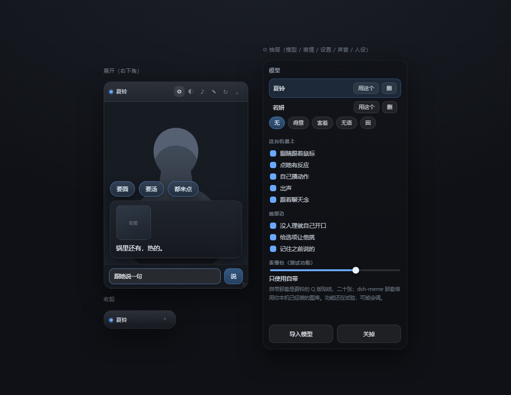

# dsh-live2dwaifu

把一只 **Live2D（Cubism 3 / 4）** 角色请进 DSH 网页的右下角。她会眨眼、会呼吸、头发会被风吹，说话时嘴一张一合，眼珠跟着鼠标走，心情变了眉毛跟着动。

她还能跟你说话——不用经过聊天框，不用进聊天记录。有自己的记忆、自己的作息、自己的声音（那种“哔哔”的电子音），高兴了甩你一张贴图。

模型**不是内置的**：谁装谁放自己的。文件全留在这台机器上，一根网线都不往外走。

> 给她一个模型，她给你一个会呼吸的角落。



| 状态 | 说明 |
|---|---|
| 展开 | 一张竖卡片：上半身、气泡、底下一个输入框 |
| 收起 | 缩成一条，只剩名字和一个 ⌃ |

---

## 装

```bash
dsh plugin --profile desktop add dsh-live2dwaifu
```

重启 DSH。右下角出现一张小卡片 → 点 ⚙ → 「导入模型」→ 选装着 `.model3.json` 的那个文件夹 → 完事。

桌面端也可以在**设置 → 插件**里搜名字安装。

**别手动解压到 `node_modules`。** DSH 只加载列在 profile `package.json` 的 `dsh.profile.bundles` 里的包。手动扔进去的名字不会自动登记，表现就是“装了但右下角什么都没有”，`/dsh-live2d/api/models` 也返回 404。真遇到了，把 `dsh-live2dwaifu` 补进 `bundles` 和 `dependencies` 再重启。

---

## 卡片

### 位置和大小

按住**标题栏**能拖到屏幕任何地方。
**改大小**：卡片左上角那个小斜纹，往左上拖变大、往右下拖变小——卡片本身钉在屏幕右下角，所以动的是它的左上角（宽 200–720，高 220–视口高−80）。
位置、大小、背景、开合状态都记在本机，下次打开还是这样。

拖到一半跑到屏幕外了？关掉重开一次就回到默认位置。

### 标题栏按钮

| 按钮 | 干什么 |
|---|---|
| **⚙** | 抽屉：模型列表、自定义表情、全部开关 |
| **◐** | 换背景：透明 / 深色 / 浅色 / 纸质 |
| **♪** | 音色调色页（每只模型各存一份音色） |
| **✎** | 人设卡编辑页 |
| **↻** | 重载 iframe（模型卡住时点这个） |
| **⌄ / ⌃** | 收起 / 展开 |

---

## 放自己的模型

1. ⚙ → 「导入模型」
2. 选**整个文件夹**，里面要有 `.model3.json`、`.moc3`、贴图，最好带 `.physics3.json`
3. 读完它自己认出模型并切过去

想放好几个也行：列表里「用这个」换人，「删」送走。

**吃**：Cubism 3 / 4（`.model3.json` + `.moc3`）。
**不吃**：Cubism 2 老格式（`.model.json` + `.moc`）。

**模型自带的动作**：有 `.motion3.json` 的，隔十几秒自己播一个；没有也能活——眨眼靠 EyeBlink 参数组，嘴动靠 `ParamMouthOpenY`，头发晃动是 `physics3.json` 的物理。

**模型自带的表情**：带 `.exp3.json` 的会在抽屉里列出来，点一下叠上去（Add / Multiply / Overwrite 照原样执行）。没带的话，内置七种：平静、开心、委屈、生气、害羞、无语、困。

**导入卡住或只导入一半**：模型大（贴图 4K）时浏览器要一张张传，慢是正常的，进度在抽屉底下显示。传一半断了就再来一次，同名文件会覆盖。

---

## 她是谁：人设卡

她说话像不像人，全看这一段字。别只写“一个可爱的女孩”——那样只会得到一段没味道的话。

人设卡存在 `~/.dsh/dsh-live2d/models/<id>/meta.json` 的 `persona` 字段里，也可以点标题栏 **✎** 在网页里改，改完她一重载就按新的说。

**值得写进去的**：

- 她是谁、几岁、做什么工作的
- 说话什么调子：短句还是长句、用不用标点、爱不爱反问
- 口头禅、习惯性的小动作、称呼你什么
- 怕什么、喜欢什么、有什么毛病
- 跟你是什么关系、你们在哪儿过日子
- 这个时间点她通常在干嘛

写得越具体越像人，写一句“性格开朗”没什么用。写完可以自己念一遍，像不像一个人在发消息。

**世界隔离**（人设卡页底下一个开关）：开着的时候，她不知道什么是程序、界面、插件、模型，问起来就当你在她身边；关掉她就老老实实承认自己是插件里的角色。默认开。

不写 `persona` 也行，会用默认那份（若妍）。

---

## 跟她说话

### 三条路

**一、卡片底下的输入框**：打一句、回车。这条线**不进你的聊天记录**，往来只存在她自己的 `chat.json` 里。

**二、手机**：手机连同一个地址，打开 `/dsh-live2d/chat`，全屏就她的脸加一个输入框，不用看整个 DSH。

> 端口每次启动可能不一样。在 DSH 设置里能看到当前地址，把它换成 `/dsh-live2d/chat` 就行。手机和电脑得在同一个局域网。

**三、别的插件推**（见下面「给别的插件用」）。

### 她记得住

记忆分两层：

- **最近二十来句**：原话，最近说了什么都在。
- **关于你的事实**：名字、作息、口味、忌讳、答应过的事——从对话里攒出来的，长期挂着。聊天时只挑跟你这句话对得上的几条带上，不会一股脑塞进提示词。

攒满三十句，前面二十句会压成小结，不丢。嫌费 token，就在 ⚙ 里把「记住之前说的」关掉。

### 她说的话会过一道筛子

模型写出来的东西先过一遍：套话会被删掉——“好的”“我理解你的感受”“希望帮到你”“还有什么需要我帮忙的吗”这些，出来就没有。最多留两三句，也允许她只回两个字。

提示词里还会明确禁止：不总结、不分点、不讲道理、不解释心情、你没问就不给建议。

> 还是觉得哪句像 AI？记下来告诉作者，往规则里加。

### 她偶尔给你选项

话说到需要你挑的地方，她会在气泡上方冒出两三个按钮，点一个就等于你回了她。

**她不给就没有**——要不要给是她自己决定的，不是每次都有。通用短答试过，效果不好，撤掉了。

### 她知道现在几点，也知道自己该在干嘛

提示词里会让她按人设推断这个时间点的处境——早上在实验室、半夜还没睡——话里自然带着那个味道。不用你提醒，也不用写死时间表。

### 她偶尔自己开口

十几分钟没人理她，她就找个话头说一句，通过卡片的气泡冒出来。嫌吵：⚙ 里关掉「没人理就自己开口」。

**开了却从不出现**？她只在页面开着的时候说，而且说出来到显示有几秒延迟（卡片每 2.5 秒拉一次）——等一会。

---

## 声音

她说话时一个字一声很短的电音，标点停一拍，句尾沉一下。不是朗读，是“哔哔”那种。

**调色**：标题栏 **♪** 打开调音页，左边是这只模型真身，右边四个预设（柔和 / 清脆 / 机械 / 游戏）加五个滑块（基频、抖动、长度、音量、语速）。边调边听，满意了点「存到这只模型」。**每只模型各存一份**，换人换声。

**安静**：⚙ 里关掉「出声」，或把音色调到音量 0。关掉之后只剩气泡和口型。

**第一次没有声音**？浏览器要求用户先点一下页面才允许出声。点她一下，或者点一下调音页的按钮，再试。

---

## 表情包（测试功能）

她说话时可能甩一张贴图，贴在气泡里。

⚙ 里有一根四档滑轴：

| 档位 | 意思 |
|---|---|
| 不使用 | 不说话配图 |
| 只使用自带 | 只用插件自带的那套 |
| 均开启 | 自带和 dsh-meme 混着来 |
| 只用 dsh-meme | 只借你本机已装的 dsh-meme 图库 |

**自带那套**是作者 OC 的 Q 版贴纸（效果不是很好其实）。

**怎么挑图**：她点名叫哪张就用哪张（提示词里给了名字清单）；没点名的话，按她这句话的情绪随机抽一张，大约三成概率。

**给 dsh-meme 用**：自带那二十张是标准图库格式，导一次就能丢给它。

```bash
python tools/export-dsh-meme.py
```

产物在 `dsh-live2d/dsh-meme-pack/xialing-001/`，整个目录丢进 `~/.dsh/profiles/desktop/node_modules/dsh-meme/memes/` 下面就认。

**图不贴题**？这功能还在试。滑到「不用」最干净。

---

## 全部开关

⚙ 抽屉底下分两栏。「这台机器上」存 localStorage，只管这一台浏览器；「她那边」存 `~/.dsh/dsh-live2d/config.json`，跟着插件走。

| 开关 | 位置 | 默认 | 说明 |
|---|---|---|---|
| 视线跟随鼠标 | 本机 | 开 | 角色的眼睛和头跟着鼠标动 |
| 点击角色有反应 | 本机 | 开 | 点她不同部位有不同反应 |
| 自动播放动作 | 本机 | 开 | 模型带动作文件时，隔一会儿播一个 |
| 说话带电子音 | 本机 | 开 | 每个字一声短音 |
| 复述聊天内容 | 本机 | 开 | 聊天窗口出现新回复时，由她念出来 |
| 闲置时主动说话 | 服务端 | 开 | 一段时间没人说话，她自己开一句 |
| 回复附带选项按钮 | 服务端 | 开 | 她觉得需要选择时，气泡上方出现可点按钮 |
| 记住聊过的内容 | 服务端 | 开 | 关掉就不带记忆、不压缩 |
| 表情包（四档） | 服务端 | 不使用 | 测试功能，见上面那节 |

「本机」存 localStorage，只影响这一台浏览器；「服务端」存 `~/.dsh/dsh-live2d/config.json`，换浏览器也一样。

---|---|---|---|
| 眼睛跟着鼠标 | 本机 | 开 | 关掉她就不看鼠标了 |
| 点她有反应 | 本机 | 开 | 摸头害羞、戳身上瞪你 |
| 自己播动作 | 本机 | 开 | 有动作文件的模型才会动 |
| 出声 | 本机 | 开 | 电子音 |
| 跟着聊天念 | 本机 | 开 | 助手每说一句她念一句 |
| 没人理就自己开口 | 她那边 | 开 | 十几分钟没人说话她说一句 |
| 给选项让他挑 | 她那边 | 开 | 气泡上方冒出可点的按钮 |
| 记住之前说的 | 她那边 | 开 | 关掉就不带记忆、不压缩 |
| 表情包（四档） | 她那边 | 不使用 | 测试功能，见上 |

---

## 给别的插件用

卡片里是个 iframe（`/dsh-live2d/viewer`）。同源脚本可以直接指挥它：

```js
const frame = document.querySelector('iframe.dsh-l2d-body');

// 说话：逐字蹦出来，嘴跟着动，可选配图
frame.contentWindow.postMessage({
  type: 'dsh-live2d/say',
  text: '窗台那盆番茄红了。',
  mood: '开心',
  image: '/dsh-live2d/ownmeme/deyi.jpg',
}, '*');

// 只换脸
frame.contentWindow.postMessage({ type: 'dsh-live2d/mood', mood: '委屈' }, '*');

// 打开模型抽屉
frame.contentWindow.postMessage({ type: 'dsh-live2d/manage' }, '*');
```

HTTP 接口，给不想碰 iframe 的：

| 方法 | 路径 | 作用 |
|---|---|---|
| GET | `/dsh-live2d/api/models` | 模型列表 + 当前选中 + 每只的音色 |
| POST | `/dsh-live2d/api/select` | `{id}` 换人 |
| POST | `/dsh-live2d/api/import?model=<id>&path=<相对路径>` | 请求体是文件字节 |
| POST | `/dsh-live2d/api/commit` | `{id,name}` 扫一遍并选中 |
| POST | `/dsh-live2d/api/delete` | `{id}` 删掉 |
| GET | `/dsh-live2d/api/voice?id=` | 读这只模型的音色 |
| POST | `/dsh-live2d/api/voice` | `{id,voice}` 存音色 |
| GET/POST | `/dsh-live2d/api/persona` | 读 / 存人设卡 |
| GET/POST | `/dsh-live2d/api/settings` | 读 / 存开关 |
| POST | `/dsh-live2d/api/chat` | `{text}` 跟她说一句，返回 `{reply,image,choices}` |
| POST | `/dsh-live2d/api/push` | `{text,image,mood}` 让她说一句（外部推送口） |
| GET | `/dsh-live2d/api/poll?since=` | 卡片每 2.5 秒拉一次，取待播的话 |

im 机器人接进来就一句话：

```bash
curl -X POST http://127.0.0.1:<端口>/dsh-live2d/api/push \
  -H 'content-type: application/json' \
  -d '{"text":"锅里有汤。","mood":"平静","from":"im"}'
```

---

## 数据存在哪

```
~/.dsh/dsh-live2d/
  config.json              现在轮到谁上场 + 各项开关
  models/<id>/
    meta.json              { name, model3, persona, isolation, voice }
    chat.json              { messages, summary, facts }  跟她私聊的记录和记忆
    <模型文件…>
```

插件自己的文件在 `~/.dsh/profiles/desktop/node_modules/dsh-live2dwaifu/`，自带的二十张贴图在 `assets/memes/`。

**想清空她对你记的事**：删掉对应模型的 `chat.json`。**想彻底重来**：整个 `~/.dsh/dsh-live2d/` 删掉，模型得重新导入。

---

## 常见问题

**右下角什么都没有**
先重启。还不来，看 profile 的 `package.json`：`dsh.profile.bundles` 和 `dependencies` 里都得有 `dsh-live2dwaifu`。手动拷进 `node_modules` 的不会自动登记。

**她只有半张脸 / 位置偏上**
模型画布比例跟卡片不一样。卡片是竖的，太宽或太扁的模型会被裁两边。拖左上角那个小斜纹改形状试试。

**导入了却不认得**
`.model3.json` 的层级选错了。选它隔壁那一层。

**她不动、不眨眼**
点一次 **↻** 重载。还不行就看浏览器控制台——多半是模型缺 `.moc3` 或缺贴图。

**跟她说话没反应**
- 确认 ⚙ 里「记住之前说的」不是全关（不影响回复，只影响记忆）
- 后台直接调 DSH 的模型接口，所以 DSH 自己得能正常对话
- 报“模型接口不可用”就是当前没有可用模型，去设置里选一个

**她说的话还是像 AI**
规则在 `lib/index.js` 的 `AI_WORDS` 和提示词那段。可以自己加词，改完重启。

**手机打不开 `/dsh-live2d/chat`**
手机和电脑得在同一个局域网；端口用 DSH 设置里显示的那个（每次启动会变）；防火墙可能挡了局域网访问。

**表情包一直不出现**
滑轴滑到「不使用」了，或者她是随机三成概率——多聊几句。只使用自带的话，确认 `assets/memes/` 里有那二十张。

**动作播得很怪 / 抽搐**
有些模型的 motion 会覆盖插件在算的参数。⚙ 里关掉「自己播动作」。

**她记得太多了 / 词太占 token**
⚙ 里关掉「记住之前说的」。或者删 `chat.json` 里不要的条目。

---

## 已知限制

- 只支持 Cubism 3 / 4，不吃 Cubism 2
- 表情只认 `.exp3.json`，不认 `.motion3.json` 里的表情轨
- 卡片是浮层（`shell.overlay`），不是聊天区分栏，会盖住右下角——能拖走、能收起
- 内置七种情绪；自定义表情一次只能叠一个
- 跟她的对话不经过 DSH 会话，所以没有工具调用、不能上网、不读文件，只说话
- 内置的 Cubism Core 是 Live2D Inc. 的 Redistributable Code，随包分发，使用受其 EULA 约束

---

## 关于别人的插件

她的图、她的耳朵，都是从你**已经装好的**插件里读的。这个包里不带任何第三方素材，也一行没改别人的代码：

- **表情图**：从 `dsh-meme` 的图库目录里挑一张，只在本机显示，不上传、不分发。没装就没有图，其它照常。
- **麦克风**：交给 `dsh-ears`，本插件不碰录音，只是把转写好的字送进对话。
- **对话**：走 DSH 自己的模型接口（`ctx.llm`），不经过任何人的会话，也不写你的聊天记录。

不喜欢这些联动，⚙ 里都能单独关掉。

---

## 致谢

- Live2D Cubism Core © Live2D Inc.
- `pixi-live2d-display` 与 `pixi.js`
- DeepSeek Harness 大肥鱼

---

MIT © LFR · npm: [`dsh-live2dwaifu`](https://www.npmjs.com/package/dsh-live2dwaifu) · [GitHub](https://github.com/FujiwaraReisen/dsh-live2dwaifu)
