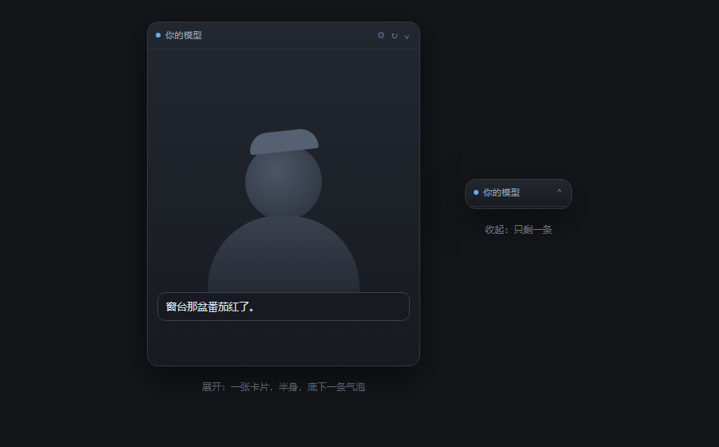

# dsh-live2dwaifu

把 **Live2D（Cubism 3 / 4）** 模型请进 DSH 网页的右下角。她会眨眼、会呼吸、头发会被风吹，说话时嘴一张一合，心情变了眉毛跟着动。

模型**不是内置的**——谁装谁放自己的。点卡片上的 ⚙，把模型文件夹整个选进去就行，文件留在这台机器上（`~/.dsh/dsh-live2d/models/`），一根网线都没往外走。

> 给它一个模型，它给你一个会呼吸的角落。



| 样子 | 说明 |
|---|---|
| 展开 | 一张小卡片，上半身，底下一条气泡装台词 |
| 收起 | 缩成一条，只剩名字和一个 ⌃ |

按住标题栏能把她拖到屏幕任何地方，右下角那个小三角拖的是大小；标题栏的 **◐** 一键换背景（透明 / 深色 / 浅色 / 纸质）。位置、大小、背景、开合状态都记在本机，下次还是这样。

**她会看你**：鼠标在窗口里走，眼珠跟着转，脑袋也偏一点。

**能戳**：点她的头会害羞，戳身上会瞪你，点底下就应你一声。

**会自己动**：模型里带 `.motion3.json` 的，隔十几秒自己播一个动作。气泡能拖着挪地方，说完过一阵自己淡下去。

**跟着聊**：她挂在聊天流上（`conversation.chat.node` 插槽），助手每说一句她就念一句，情绪按话里的词换。

## 三十秒上手

```bash
dsh plugin --profile desktop add dsh-live2dwaifu
```

重启 DSH，右下角出现一张小卡片 → 点 ⚙ → 点「导入模型」→ 选那个装着 `.model3.json` 的文件夹 → 完事。

导入的时候浏览器会一个一个把文件搬进去，模型大点就多等几秒，进度在底下会说话。

## 放自己的模型

1. 卡片右上角 ⚙ → 「导入模型」
2. 选**整个文件夹**（里面要有 `.model3.json`、`.moc3`、贴图，最好还有 `.physics3.json`）
3. 读完它会自己认出哪个是模型，并切过去

想放好几个也行，列表里点「用这个」换人，「删」送走。

**能吃什么**：Cubism 3 / 4（`.model3.json` + `.moc3`）。
**吃不了什么**：Cubism 2 的老格式（`.model.json` + `.moc`）。

**自定义表情**：模型文件夹里带 `.exp3.json` 的，导入后在 ⚙ 面板里会列出来，点一下就叠上去（Add / Multiply / Overwrite 三种混合照原样执行）。Cubism 4 的 `.exp3.json` 直接从原画软件导出即可。

**没有动作文件也能活**：眨眼靠 EyeBlink 参数组，嘴动靠 `ParamMouthOpenY`，头发晃动是 `physics3.json` 自带的物理；表情是本插件拿标准参数（`ParamEyeLSmile`、`ParamMouthForm`、`ParamBrow*`、`ParamAngle*`）现摆的，一共七种：平静、开心、委屈、生气、害羞、无语、困。

## 让它说点什么

卡片里是个 iframe（`/dsh-live2d/viewer`）。别的插件、脚本、控制台都能指挥它：

```js
const frame = document.querySelector('iframe.dsh-l2d-body');

// 说话：逐字蹦出来，嘴跟着动
frame.contentWindow.postMessage({ type: 'dsh-live2d/say', text: '窗台那盆番茄红了。', mood: '开心' }, '*');

// 只换脸
frame.contentWindow.postMessage({ type: 'dsh-live2d/mood', mood: '委屈' }, '*');

// 打开模型管理
frame.contentWindow.postMessage({ type: 'dsh-live2d/manage' }, '*');
```

同源的 HTTP 接口，给不服 iframe 的人：

| 方法 | 路径 | 作用 |
|---|---|---|
| GET | `/dsh-live2d/api/models` | 列出模型和当前选中的那只 |
| POST | `/dsh-live2d/api/select` | `{id}` 换人 |
| POST | `/dsh-live2d/api/import?model=<id>&path=<相对路径>` | 请求体就是文件字节 |
| POST | `/dsh-live2d/api/commit` | `{id,name}` 扫一遍 model3 并选中 |
| POST | `/dsh-live2d/api/delete` | `{id}` 删掉 |

## 东西都放哪了

```
~/.dsh/dsh-live2d/
  config.json            # 现在轮到谁上场
  models/<id>/           # 模型文件，相对结构原样保留
    meta.json            # { name, model3 }
```

## 一些常见的小脾气

**右下角什么都没有？**
先重启一次 DSH。还不来，看 profile 的 `package.json`：`dsh.profile.bundles` 里得有 `dsh-live2dwaifu`，`dependencies` 里也得有。用 `dsh plugin add` 装的会自动写进去；手动解压到 `node_modules` 的不会——DSH 只加载列在 `bundles` 里的包，名字漏了就当没装，`/dsh-live2d/api/models` 也会 404。

**导入了却不认得？**
多半是文件夹选得太靠上或太靠下，`.model3.json` 就在里面那一层，选它隔壁那层。

**她只有半张脸？**
这个模型的画布比例跟面板不一样。面板是竖的，太宽或太扁的模型会被裁两边。

**能放动作吗？**
暂时不能编排 `.motion3.json`，表情是固定的七种。想要更多情绪，给它发 `mood`，等以后的版本。

## 已知限制

- 只支持 Cubism 3 / 4（表情只认 `.exp3.json`，不认 `.motion3.json` 里的表情轨）
- 面板是浮层（`shell.overlay`），不是聊天区分栏；会盖住右下角，能收起
- 内置七种情绪；自定义表情靠模型自带的 `.exp3.json`，一次只能叠一个
- 内置的 Cubism Core 是 Live2D Inc. 的 Redistributable Code，随包分发，使用受其 EULA 约束

---

MIT © LFR · npm: [`dsh-live2dwaifu`](https://www.npmjs.com/package/dsh-live2dwaifu)
